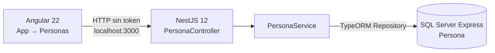

# Diagnóstico base del CRUD — Auditoría F0 anterior

> **Naturaleza:** línea base histórica entregada por el usuario en noviembre de 2026. No describe necesariamente el estado actual: el proyecto ha avanzado después de esta auditoría. Toda verificación debe repetirse sobre el workspace actual.
>
> **Alcance de la auditoría original:** lectura/inspección; no se ejecutaron pruebas, builds ni comandos que modificaran artefactos. No se verificó directamente el esquema real de la base de datos.

## 1. Confirmación de lectura de directrices

Claude Code confirmó que la jerarquía de fuentes es: directrices vigentes; decisiones del equipo; documentos de planeación aprobados; código como evidencia de lo implementado y no como autoridad de negocio. Confirmó también que la auditoría inicial fue de solo lectura.

## 2. Resumen ejecutivo del CRUD original

El CRUD era una aplicación mínima de gestión de `Persona`, con una sola entidad y siete endpoints. La mayoría del dominio funcional LIS no existía. El andamiaje separado de frontend/backend y la validación global de DTOs eran reutilizables.

| Hecho verificado en la auditoría original | Valor |
|---|---|
| Frontend | Angular 22.1.7, componentes standalone |
| Backend | NestJS 12.0.3 con TypeScript |
| ORM | TypeORM 1.1.1 |
| Driver | `mssql` 12.7.2 |
| Motor | SQL Server Express |
| Base referida por configuración | `FundacionUniversitaria` |
| Entidades | 1: `Persona` |
| Endpoints | 7: Hello World y operaciones de Persona |
| Migraciones/scripts SQL | No se encontraron en el repositorio auditado |
| Autenticación/RBAC | No existían en esa versión auditada |
| Git | Cero commits; archivos sin seguimiento en la inspección |

## 3. Arquitectura observada entonces



### Frontend

- Un único componente `Personas` con formulario y tabla, utilizado directamente por `App`.
- Servicio HTTP con URL de API escrita en el código.
- Archivo de rutas vacío.
- Sin guards, interceptors ni archivos de entorno.

### Backend

- Módulo raíz y `PersonaModule`.
- Patrón controller/service/repository/DTO.
- `ValidationPipe` global con `whitelist` y `forbidNonWhitelisted`.
- CORS abierto a cualquier origen.
- `PUT /personas/:id` recibía cuerpo `any` y no aplicaba DTO específico.
- `DELETE /personas/:id` hacía borrado físico.

### Entidad

`Persona` contenía `id`, `nombre`, `apellido`, `correo` único, `telefono`, `tipoPersona` y `activo`.

Se observó una discrepancia: `telefono` era opcional en la entidad y obligatorio en el DTO de creación. Los valores de `tipoPersona` incluían `Estudiante`, `Fundacion` y `Administrador`; no debía mapearse automáticamente `Fundacion` a `DONADOR` sin decisión del equipo.

## 4. Endpoints observados entonces

```text
GET    /                         Hello World
POST   /personas                 valida CreatePersonaDto
GET    /personas                 lista todos; incluye correo y teléfono
GET    /personas/correo/:correo  busca por correo; sin autenticación
GET    /personas/:id
PUT    /personas/:id             body tipado como any; sin validación DTO
DELETE /personas/:id             borrado físico
```

## 5. Riesgos observados entonces

### Seguridad — altos

- Credenciales de la base de datos escritas directamente en `backend/src/app.module.ts`.
- No había autenticación en endpoints.
- Listado y búsqueda por correo exponían identidad y datos de contacto.
- El formulario Angular permitía seleccionar el tipo de persona; el backend no debía confiar en roles definidos por el cliente.
- `PUT` sin DTO permitía cambiar campos sensibles como `tipoPersona` y `activo`.
- CORS abierto a cualquier origen.

**Precaución:** no revelar ni volver a copiar valores de credenciales. Antes de cualquier commit debe comprobarse que los secretos están fuera del repositorio, revisar `.gitignore` y evaluar rotación si las credenciales eran reales.

### Integridad y manejo de errores

- Un correo duplicado podía terminar en error 500 en lugar de conflicto 409.
- Un ID no numérico podía convertirse en `NaN` al no utilizar `ParseIntPipe`.
- Un ID inexistente podía devolver resultado vacío en lugar de 404.
- Errores de carga y eliminación no se manejaban correctamente en la interfaz.
- El componente almacenaba un mensaje de error del backend, pero la plantilla no lo mostraba.

### Base de datos y migración

- `synchronize` de TypeORM estaba desactivado.
- No se encontraron migraciones ni scripts SQL.
- El esquema real de `FundacionUniversitaria` no pudo verificarse desde el repositorio y podía diferir de la entidad.
- Pasar de SQL Server a MySQL implicaría revisar tipos, autoincrementos, restricciones y datos existentes.
- No había transacciones ni bloqueos para evitar sobreasignaciones concurrentes.

### Pruebas

Por inspección se estimó que cinco de siete pruebas probablemente fallarían, pero **no se ejecutaron**. Las causas señaladas fueron:

- Prueba del servicio Angular importa `Persona` desde un archivo donde no existe.
- Prueba de `App` espera el título `Hello, frontend`, que ya no coincide.
- Prueba del componente no proporciona `HttpClient`.
- Pruebas del controlador y servicio de backend no proporcionan el repositorio.
- Prueba e2e requiere la base de datos real.

La auditoría posterior debe ejecutar y verificar las pruebas actuales; no repetir estas estimaciones como resultados.

## 6. Reutilización propuesta en la auditoría original

| Componente | Tratamiento propuesto entonces |
|---|---|
| Angular standalone y Prettier | Reutilizar |
| Bootstrap NestJS y ValidationPipe | Reutilizar, endureciendo CORS |
| Patrón controller/service/repository/DTO | Reutilizar y ampliar |
| TypeORM | Reutilizable; incorporar migraciones |
| Configuración conexión BD | Modificar; sacar secretos y resolver motor |
| Entidad Persona | Modificar/refactorizar según modelo de identidad aprobado |
| CRUD Personas / alta manual / `tipoPersona` | Reemplazar o transformar según nuevo modelo |
| Auth Google, RBAC y privacidad | Construir |
| Ofertas, peticiones, `OFERTA_X_PETICION`, LOCAL, inventario, estados, plazos, algoritmo, notificaciones, fotos y auditoría | Construir |

## 7. Decisiones técnicas pendientes identificadas entonces

- Directriz del profesor: MySQL y backend JavaScript.
- Código auditado: SQL Server Express y NestJS/TypeScript.
- Confirmar con el profesor si NestJS/TypeScript satisface el requisito de backend JavaScript.
- Confirmar si MySQL es obligatorio o si se acepta SQL Server.
- Verificar si la base `FundacionUniversitaria` contiene datos que deban conservarse y localizar posibles scripts/esquemas externos.
- Definir almacenamiento privado de fotografías y restricciones de despliegue.

## 8. Ubicación del workspace

La auditoría inicial señaló que la sesión se encontraba en otra copia o subcarpeta `Estructura de datos/frontend`. Se recomendó abrir la raíz completa `Manejo de donaciones LIS/Proyecto Fund`, con frontend y backend. La auditoría nueva debe comprobar cuál es la raíz correcta y no asumir que esa ruta sigue siendo válida.
