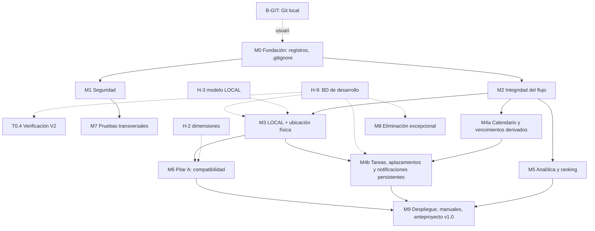

# Plan de cierre — LIS Dona

> **HISTÓRICO (línea base del 2026-11-20).** Este documento ya no describe el estado actual. El estado vigente está en `README.md`, `docs/01_decisiones_y_pendientes.md` (D-01 a D-67) y `docs/planeacion/MATRIZ_CUMPLIMIENTO_RUBRICA.md` (2026-11-26). Las tareas bloqueadas por H-2, H-3 y H-9 se resolvieron con D-41, D-43 y D-37.

| Campo | Valor |
|---|---|
| Versión | 1.0 |
| Fecha | 2026-11-20 |
| Base | `INFORME_ETAPA_A_2026-11-20.md` (auditoría integral + V1) |
| Protocolo | `prompts/PROMPT_CONTINUACION_AUTONOMA_LIS.md` (autonomía supervisada por lotes) |
| Estados de tarea | PENDIENTE · EN CURSO · HECHO (con evidencia) · BLOQUEADO (con causa) · DISEÑADO |

> Este documento es vivo. Cada lote actualiza el estado, la evidencia y la fecha. La matriz por criterio de rúbrica está en `MATRIZ_CUMPLIMIENTO_RUBRICA.md`; las decisiones técnicas provisionales, en `REGISTRO_DECISIONES.md`.

## 1. Estrategia

1. **No reconstruir lo que ya funciona.** El núcleo (autenticación, ofertas, peticiones, asignación transaccional, custodia y entrega, KD-tree) se conserva y se corrige de forma puntual.
2. **Primero lo que no depende de decisiones externas ni de la BD:** seguridad, integridad del flujo, lógica pura de los pilares B y C, y pruebas con dobles (mocks).
3. **Todo lo que necesita cambios de esquema** (LOCAL, tareas persistentes, notificaciones, auditoría de eliminaciones) se diseña y se deja en scripts **no aplicados** hasta que se confirme H-9 (BD de desarrollo) y se autorice la migración.
4. **El proyecto siempre queda ejecutable:** ningún código en tiempo de ejecución depende de tablas que todavía no existan.

## 2. Bloqueos activos

| ID | Bloqueo | Afecta | Quién lo resuelve |
|---|---|---|---|
| B-GIT | El entorno (clasificador de auto mode) denegó `git init`. | T0.1 | Usuario: ejecutar los comandos de §6 o autorizar la regla de permisos. |
| H-9 | No está confirmado que `LisDona` sea una BD de desarrollo sin datos reales. | T0.4 (V2), aplicar scripts `db/03+`, e2e con BD | Usuario |
| H-1 | Falta la confirmación escrita del profesor sobre SQL Server / TypeScript. | Evidencia de rúbrica (no bloquea código) | Equipo + profesor |
| H-2 | Dimensiones de compatibilidad del árbol (P-09). | T6.2 (reemplazar el algoritmo productivo) | Equipo + profesor |
| H-3 | Modelo de LOCAL y ubicación física aprobado. | T3.2–T3.4 | Equipo |
| H-4 | Duración y número de aplazamientos (P-07), inicio de la custodia LOCAL (P-08), fuente de cierres (P-12). | Parámetros de T4.x (se usan valores configurables [PROP]) | Equipo |
| H-5 | Pesos del ranking (P-11). | Valores por defecto de T5.x ([PROP] configurables) | Equipo |
| H-6 | Proveedor SMTP y credenciales. | Envío real de correo en T4.5 | Equipo |

## 3. Diagrama de dependencias



## 4. Backlog por módulos

**Prioridades:** P0 bloquea seguridad, datos o decisiones · P1 requisito de la rúbrica o del MVP · P2 cierre y calidad · P3 mejora.

### M0 — Fundación (P0)

| ID | Tarea | Archivos | Aceptación | Estado |
|---|---|---|---|---|
| T0.1 | Git local + commit base revisado (sin `.env`, `dist`, `node_modules`, cachés) | raíz | `git status` limpio tras el commit; `git diff --cached --stat` revisado | **BLOQUEADO (B-GIT)** |
| T0.2 | Endurecer `.gitignore` (`.env.*`, configuración local, zip) | `.gitignore` | Las reglas existen | HECHO 2026-11-20 |
| T0.3 | Registrar D-31…D-36, P-21…P-25 y supuestos H-7 | `docs/01_decisiones_y_pendientes.md`, `REGISTRO_DECISIONES.md` | Registro actualizado | HECHO 2026-11-20 |
| T0.4 | Verificación V2 (arranque, `/salud`, GET de catálogos, 401 negativos) | — | Salidas registradas como evidencia de R1 | **BLOQUEADO (H-9)** |
| T0.5 | Confirmación escrita del profesor (stack y pilar A) | evidencia | PDF o captura archivada | PENDIENTE (equipo) |

### M1 — Seguridad y privacidad (P1 · R2, R3)

| ID | Tarea | Archivos | Aceptación | Riesgo |
|---|---|---|---|---|
| T1.1 | El guard JWT revalida en la BD que el usuario esté activo y sus roles vigentes (el bloqueo y la revocación surten efecto inmediato) | `auth/jwt.guard.ts`, `auth/auth.service.ts` | Pruebas unitarias: bloqueado → 401; rol revocado → sin privilegios; ruta pública con usuario bloqueado → invitado | Una consulta extra por petición (aceptable en el MVP) |
| T1.2 | `fotoId` de una oferta: solo una evidencia subida por el mismo donador, no usada en movimientos ni en otra oferta | `ofertas/ofertas.service.ts` | Pruebas: foto ajena → 403; foto de movimiento → 400 | — |
| T1.3 | Fotos de movimientos físicos solo para el personal del LIS (H-7d); el detalle de asignación no expone `evidenciaId` a las partes | `evidencias/evidencias.service.ts`, `asignaciones/asignaciones.service.ts` | Pruebas de `puedeVer` por rol | — |
| T1.4 | `AUXILIAR_LIS` solo para el perfil DONADOR, es decir, cuentas no institucionales (D-04) | `usuarios/usuarios.service.ts` | Prueba: otorgar auxiliar a un ESTUDIANTE → 400 | — |
| T1.5 | `/api/salud` sin el mensaje de error de la BD (se registra solo en el log del servidor) | `health/health.controller.ts` | Prueba: BD caída → `degradado` sin `detalle` | — |

### M2 — Integridad del flujo central (P1 · R4)

| ID | Tarea | Archivos | Aceptación |
|---|---|---|---|
| T2.1 | El catálogo de peticiones oculta las que tienen una asignación vigente (directriz §3) | `peticiones/peticiones.service.ts` | Prueba unitaria |
| T2.2 | Saldo de oferta en una sola función pura. La recepción incompleta **consume** las unidades del intento cancelado (no las devuelve a la oferta original) para no duplicar inventario | `ofertas/saldo.ts` (nuevo), `ofertas.service.ts`, `asignaciones.service.ts`, `emparejamiento.service.ts`, `db/01_schema.sql` (vista, sin aplicar) | Pruebas: 10 ofertadas, 5 asignadas, llegan 3 → original disponible 5, oferta nueva 3; total 8 ≤ 10 |
| T2.3 | Límite de 5 peticiones dentro de una transacción con bloqueo de la fila del estudiante | `peticiones/peticiones.service.ts` | Prueba con un doble del gestor transaccional |
| T2.4 | La devolución exige la cantidad completa (no hay movimientos parciales) | `asignaciones/asignaciones.service.ts` | Prueba unitaria |

### M3 — LOCAL y ubicación física (P1 · R4)

| ID | Tarea | Estado |
|---|---|---|
| T3.1 | Documento de diseño con alternativas (destino institucional en `OFERTA_X_PETICION` con XOR, frente a una tabla de recepción institucional) y modelo de ubicación física (`LOTE_FISICO`) | PENDIENTE (siguiente lote documental) |
| T3.2 | Script `db/03_local_ubicacion.sql` (sin aplicar) | BLOQUEADO hasta H-3 |
| T3.3 | Servicio de destino LOCAL, autorización del administrador, LOCAL como última opción | BLOQUEADO hasta H-3 + H-9 |
| T3.4 | Reasignación desde custodia sin recepción ficticia | BLOQUEADO hasta H-3 + H-9 |

### M4 — Pilar B: ciclo de vida (P1 · R6)

| ID | Tarea | Archivos | Aceptación | Estado |
|---|---|---|---|---|
| T4.1 | Calendario hábil colombiano **calculado**, sin fechas fijas: festivos fijos, festivos trasladables (Ley 51 de 1983) y festivos que dependen de la Pascua; zona `America/Bogota`; cierres del LIS como entrada configurable | `calendario/festivos-colombia.ts`, `calendario/dias-habiles.ts` | Pruebas: festivos oficiales de 2025 y 2026 exactos; suma de días hábiles que cruza fines de semana, festivos y cierres | PENDIENTE |
| T4.2 | Vencimientos **derivados** sin esquema nuevo: límite del donador = asignación + 10 días hábiles; límite del estudiante = recepción + 3 días hábiles; bandeja `DEFINIR_ESTADO` calculada | `plazos/plazos.service.ts`, `plazos/plazos.controller.ts` | Pruebas: estados vigente, próximo a vencer y vencido | PENDIENTE |
| T4.3 | UI: bandeja de vencimientos para el personal del LIS | `frontend/.../vencimientos.component.ts` | Compila (`ng build`) | PENDIENTE |
| T4.4 | Esquema persistente: `TAREA`, `NOTIFICACION`, `CIERRE_LIS`, `FESTIVO_AJUSTE`, prórrogas (`PLAZO_AJUSTE`) | `db/04_ciclo_vida.sql` (sin aplicar) | — | BLOQUEADO para aplicar (H-9) |
| T4.5 | Adaptador de correo (interfaz + bandeja de salida; sin envíos reales) y buzón interno | `notificaciones/` | — | BLOQUEADO (H-6, H-9) |
| T4.6 | Aplazar 3 días, extender y reasignar desde la tarea | — | — | BLOQUEADO (T4.4, M3) |

### M5 — Pilar C: analítica y ranking (P1 · R7)

| ID | Tarea | Archivos | Aceptación | Estado |
|---|---|---|---|---|
| T5.1 | Fórmulas puras: indicadores, reputación de estudiantes (peticiones, ayudas, incumplimientos) y de donadores (completadas frente a fallidas), normalizadas a [0,1], con pesos configurables [PROP] y separadas de la prioridad | `analitica/formulas.ts` | Pruebas con ejemplos calculados a mano | PENDIENTE |
| T5.2 | Servicio y endpoints de solo lectura sobre las tablas existentes (sin esquema nuevo), solo para el personal del LIS | `analitica/*` | Pruebas del servicio con repositorios dobles y de guards por rol | PENDIENTE |
| T5.3 | Alertas de incumplimiento (umbral configurable) | `analitica/formulas.ts` | Prueba | PENDIENTE |
| T5.4 | UI: panel de analítica | `frontend/.../analitica.component.ts` | Compila | PENDIENTE |

### M6 — Pilar A: refinamiento (P1 · R5)

| ID | Tarea | Estado |
|---|---|---|
| T6.1 | Análisis comparativo H-2 + benchmark aislado (construcción + consulta frente a lineal y ordenamiento) sin cambiar el comportamiento productivo | PENDIENTE |
| T6.2 | Árbol sobre atributos de compatibilidad + prioridad como orden posterior | BLOQUEADO (H-2) |
| T6.3 | LOCAL como última opción | BLOQUEADO (M3) |

### M7 — Pruebas transversales (P1 · R8)

Cada módulo trae sus pruebas unitarias. Las pruebas e2e con BD desechable quedan BLOQUEADAS (H-9). El runner de pruebas del frontend necesita una dependencia nueva y se evaluará en un lote posterior (P2).

### M8 — Eliminación excepcional con reautenticación (P1 · R8)

Diseño: nuevo ID token de Google interactivo, validado en el backend con `iat` dentro de una ventana configurable; justificación obligatoria; tabla `AUDITORIA_ELIMINACION` inmutable; anonimización en lugar de borrado físico. **BLOQUEADO para runtime (H-9, esquema).**

### M9 — Cierre (P2)

| ID | Tarea | Estado |
|---|---|---|
| T9.1 | Restaurar la sesión antes de evaluar los guards de Angular (inicializador de la app) | PENDIENTE |
| T9.2 | Anteproyecto académico v1.0 corregido (independiente del original) | PENDIENTE |
| T9.3 | README: retirar afirmaciones no verificadas y documentar los módulos nuevos | PENDIENTE |
| T9.4 | Despliegue identificable y `environment.prod.ts` real | BLOQUEADO (decisión de despliegue) |
| T9.5 | Manuales de usuario y técnico, guion de demo, matriz de evidencias | PENDIENTE |
| T9.6 | Migraciones versionadas o tabla de versión del esquema | DISEÑADO (requiere H-9) |
| T9.7 | Inmutabilidad de `HISTORIAL_ESTADO` con trigger | DISEÑADO (requiere H-9) |

## 4.1 Estado de ejecución (actualizado 2026-11-20, lotes A y B1–B4)

| Tarea | Estado | Evidencia |
|---|---|---|
| T0.1 Git | **BLOQUEADO (B-GIT)** | El clasificador de auto mode denegó `git init` (dos intentos, el segundo sin identidad ni commit) |
| T0.2 `.gitignore` | HECHO | `.gitignore` |
| T0.3 Registros | HECHO | `docs/01_decisiones_y_pendientes.md`, `REGISTRO_DECISIONES.md` |
| T0.4 V2 | BLOQUEADO (H-9) | — |
| T1.1 JWT revalida en la BD | **HECHO Y VERIFICADO** | `auth/jwt.guard.spec.ts` (8) |
| T1.2 `fotoId` propio | **HECHO Y VERIFICADO** | `seguridad.spec.ts` (5) |
| T1.3 Fotos de movimientos solo LIS | **HECHO Y VERIFICADO** | `seguridad.spec.ts` (6), `flujo-integridad.spec.ts` (1) |
| T1.4 Auxiliar no institucional | **HECHO Y VERIFICADO** | `seguridad.spec.ts` (3) |
| T1.5 `/salud` sin detalle | **HECHO Y VERIFICADO** | `seguridad.spec.ts` (2) |
| R2 Google + dominio (prueba adicional) | **VERIFICADO** | `auth/auth.spec.ts` (11) |
| T2.1 Catálogo oculta asignadas | **HECHO Y VERIFICADO** | `flujo-integridad.spec.ts` (2) |
| T2.2 Saldo único sin duplicación | **HECHO Y VERIFICADO** | `saldo.spec.ts` (6), `flujo-integridad.spec.ts` (2). La vista SQL se actualizó en el script, **sin aplicar** |
| T2.3 Límite de 5 transaccional | **HECHO Y VERIFICADO** (con doble transaccional; la concurrencia real requiere BD) | `flujo-integridad.spec.ts` (2) |
| T2.4 Devolución completa | **HECHO Y VERIFICADO** | `flujo-integridad.spec.ts` (2) |
| T3.1 Diseño LOCAL + lote físico | **DISEÑADO** | `DISENO_LOCAL_Y_UBICACION_FISICA.md` |
| T4.1 Calendario hábil | **HECHO Y VERIFICADO** | `calendario/calendario.spec.ts` (11) |
| T4.2 Plazos y DEFINIR_ESTADO derivados | **HECHO Y VERIFICADO** (unitario) | `pilares-b-c.spec.ts` (9 de plazos) |
| T4.3 UI de plazos | HECHO (compila) | `frontend/src/app/paginas/vencimientos.component.ts`; `ng build` exit 0 |
| T5.1–T5.3 Analítica | **HECHO Y VERIFICADO** (unitario) | `pilares-b-c.spec.ts` (fórmulas, servicio, RBAC) |
| T5.4 UI de analítica | HECHO (compila) | `analitica.component.ts`; `ng build` exit 0 |
| T6.1 Análisis H-2 + benchmark | HECHO | `ANALISIS_PILAR_A_KDTREE.md`, `backend/scripts/benchmark-kdtree.ts` |
| T9.1 Sesión antes de los guards | HECHO (compila; no probado en navegador) | `frontend/src/app/app.config.ts` |
| T9.3 README | HECHO | `README.md` §8–§11 |
| — `tsconfig.build.json` | HECHO | `dist/` sin specs |

**Total de pruebas del backend:** 8 suites, **89/89**, exit 0 (al inicio de los lotes: 7).

**Siguiente lote no bloqueado:**
1. T9.2: anteproyecto académico v1.0, como documento independiente.
2. T9.5: guion de demo y manual de usuario.
3. Pruebas e2e HTTP con la app Nest y servicios dobles (sin BD).

## 4.2 Replanificación por las indicaciones complementarias (D-37…D-44, 2026-11-20)

**Contradicciones encontradas en el código actual y cómo se resuelven:**

| # | Código actual | Regla nueva | Resolución |
|---|---|---|---|
| C1 | KD-tree sobre caracterización, Sisbén y antigüedad hacia el punto fijo (1,1,1) | D-41: el árbol busca compatibilidad con atributos del producto | **Reemplazar** por un KD-tree de rango sobre atributos de compatibilidad; la prioridad se aplica después |
| C2 | Antigüedad = días / máximo de la consulta | D-38: estable y reproducible | Antigüedad = min(1, días desde `creada_en` / horizonte configurable) |
| C3 | La UI muestra la prioridad y los pesos como porcentajes | D-38: número real, sin porcentajes | Mostrar con 3 decimales y escala documentada [0,1] |
| C4 | El auxiliar recibe `grupoSisben` | D-39 | Solo el administrador lo ve; el auxiliar ve componentes numéricos |
| C5 | Solo se guarda el puntaje total en la asignación | D-38: guardar componentes | Columnas de componentes en `OFERTA_X_PETICION` |
| C6 | Donadores con reputación suavizada | D-40: indicador directo | Tasa = completadas / (completadas + fallidas) |
| C7 | Plazos derivados, sin tareas ni notificaciones persistentes | D-42 | Tablas `TAREA`, `NOTIFICACION`, `CORREO_SALIDA`, programador, reintentos |
| C8 | LOCAL ausente; reasignación con recepción ficticia | D-43 | `DESTINO_LOCAL`, `LOTE_FISICO`, reasignación sin recepción |
| C9 | Cierres en `PARAMETRO.CIERRES_LIS` | D-37 (se puede modificar la BD) | Tabla `CIERRE_LIS`; el parámetro queda como respaldo |

**Nuevos módulos, en orden de ejecución:**

| Módulo | Contenido | Afecta |
|---|---|---|
| M-DB | Verificación (hecha), respaldo, ejecutor de migraciones versionadas (`db/migraciones/NNN_*.sql`, tabla `ESQUEMA_VERSION`) | `backend/scripts/db/`, `db/migraciones/` |
| M-PRIO | Prioridad con componentes estables y persistidos, sin porcentajes, Sisbén oculto al auxiliar | `emparejamiento/`, entidad OXP, `emparejamiento.component.ts` |
| M-KD | Atributos de compatibilidad (estado de conservación y medida por categoría), KD-tree de rango, emparejamiento en dos fases, formularios, explicación académica y benchmark | `CATEGORIA`, `OFERTA`, `PETICION`, `emparejamiento/`, formularios Angular, `docs/academico/` |
| M-LOCAL | Lote físico, destino LOCAL (custodia temporal frente a aceptación del administrador), reasignación sin recepción | Nuevas tablas, `asignaciones/`, nuevo `local/`, `custodia.component.ts` |
| M-NOTIF | Bandeja + correo (adaptador SMTP con nodemailer), tareas `DEFINIR_ESTADO` persistentes, aplazar o extender, programador de vencimientos | Nuevos `notificaciones/`, `tareas/`, `plazos/`; UI de bandeja |
| M-ANAL | Indicador directo de donadores, explicación de factores, dataset y hoja de validación | `analitica/`, `docs/validacion/` |
| M-DEMO | Datos ficticios, restauración del escenario y guion de demo | `db/demo/`, `docs/demo/` |

## 5. Definición global de "terminado"

Un criterio de la rúbrica está terminado cuando:

1. Está implementado en el backend, con autorización aplicada en el servidor.
2. Tiene pruebas automatizadas que pasan.
3. Se demostró en ejecución con datos ficticios (V2/V3).
4. Está documentado en la matriz, con evidencia (comando, resultado, captura).

Que compile no basta para considerarlo verificado.

## 6. Comandos pendientes para el usuario (B-GIT)

Ejecutar desde la raíz `lis-dona/lis-dona`, revisando la salida antes de confirmar:

```bash
git init -b main
git config user.name "<nombre del equipo>"
git config user.email "<correo>"
git add .gitignore CLAUDE.md README.md db docs prompts \
  backend/.gitignore backend/.env.example backend/nest-cli.json backend/package.json backend/package-lock.json backend/tsconfig.json backend/src \
  frontend/.gitignore frontend/angular.json frontend/package.json frontend/package-lock.json frontend/tsconfig.json frontend/tsconfig.app.json frontend/src
git status --short
git diff --cached --name-only | grep -E '(^|/)\.env$|node_modules|/dist/|\.angular' && echo "DETENERSE" || echo "OK"
git commit -m "Commit base LIS Dona (estado auditado 2026-11-20)"
```

## 7. Historial de este plan

| Fecha | Cambio |
|---|---|
| 2026-11-20 | v1.0: creado a partir de la auditoría de la Etapa A y del protocolo de continuación autónoma. |
| 2026-11-20 | v1.1: lotes B1 (seguridad), B2 (integridad), B3 (Pilar C), B4 (Pilar B derivado), T6.1, T3.1 y T9.1 ejecutados; estado en §4.1. |
